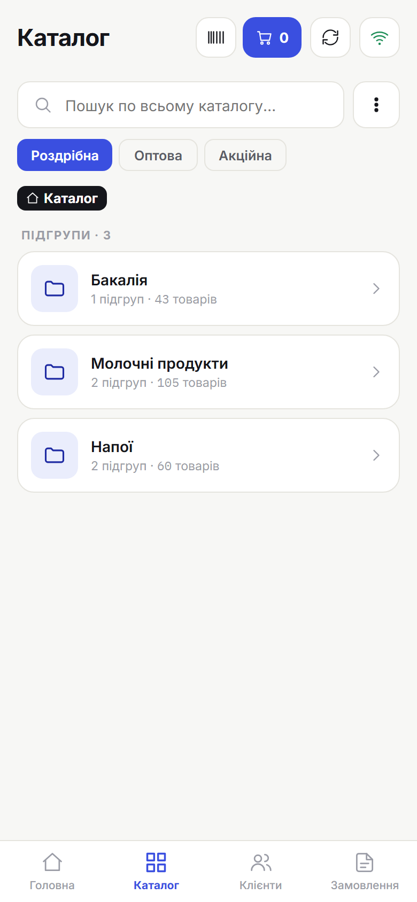
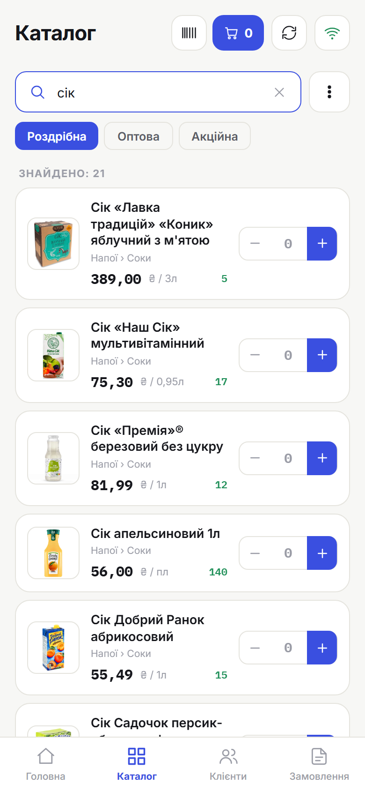
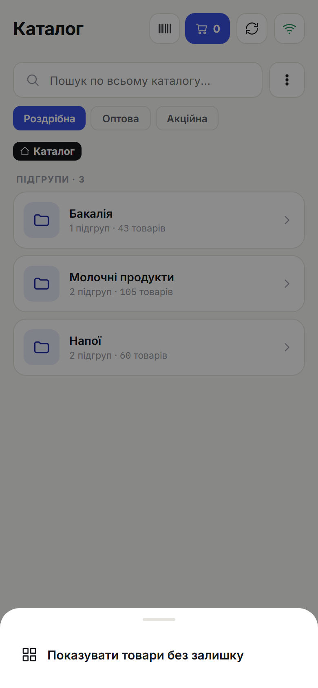
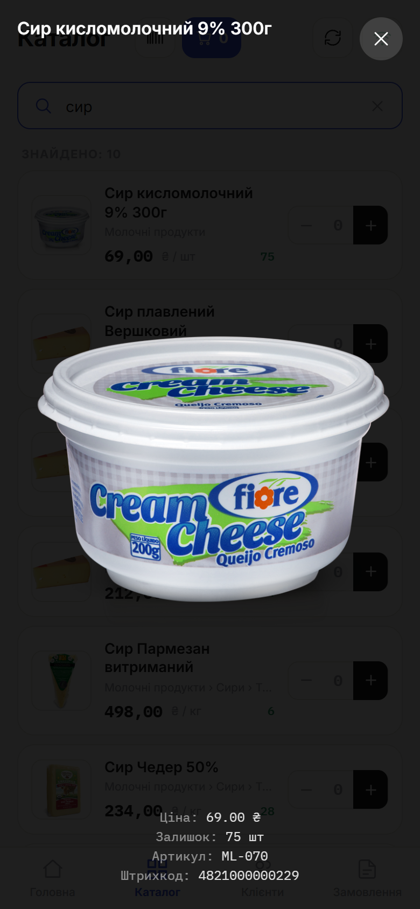
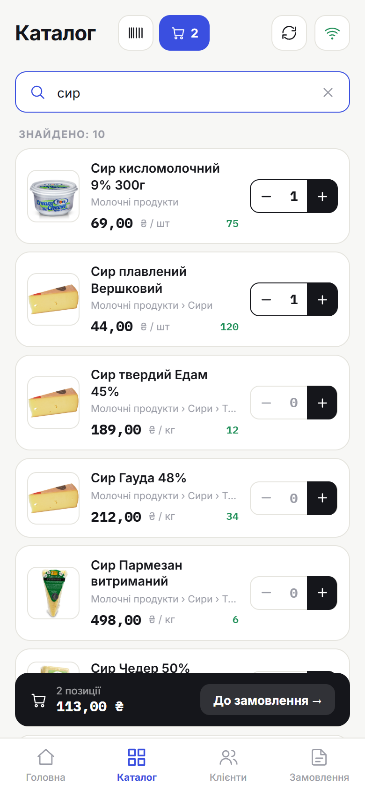

# 2. Каталог товарів

> **Коли це потрібно:** знайти товар і додати його до замовлення.

## Як відкрити
Нижня навігація → **Каталог**.

## Знайти товар
- **Перегляд груп:** заходь у групи й підгрупи; стрілка «назад» (угорі або апаратна) повертає на рівень вище.
- **Пошук:** введи назву, артикул або штрихкод у полі пошуку.
- **Сканер штрихкодів:** натисни значок сканера й піднеси камеру до штрихкоду товару.

## Меню дій
Праворуч від поля пошуку — кнопка **⋮** (три крапки). Відкриває меню додаткових дій каталогу.

- **Прайс** — сформувати прайс-лист файлом і одразу надіслати клієнту (див. нижче). Пункт зʼявляється, лише якщо адміністратор увімкнув цей блок.
- **Показувати товари без залишку** — перемикач, яким можна **показати або приховати** товари, яких немає в наявності (нульовий залишок). Типово **вимкнено**: недоступні товари **приховані** (і в групах, і в пошуку). Увімкни — вони зʼявляться **в кінці** списку. Стан запамʼятовується.

> Лічильники товарів («N товарів» на картці групи, «ТОВАРИ · N») показують кількість **з урахуванням** цього перемикача: поки недоступні приховані — рахуються лише товари в наявності.

## Тип ціни
Якщо для пристрою налаштовано **кілька типів цін**, під пошуком зʼявляється ряд чіпів
(напр. «Роздрібна», «Оптова»). Тапни потрібний — ціни в каталозі одразу перерахуються.
Якщо тип один — селектор не показується.

**Одне замовлення — один тип цін.** Поки кошик порожній, тип перемикається вільно. Коли
в замовленні вже є товари й ти вибираєш **інший** тип:
- застосунок спитає, чи **перерахувати** ціни замовлення на новий тип (**«Перерахувати»** —
  так, **«Лишити поточний»** — залишити як є);
- якщо на якийсь із доданих товарів **немає ціни** нового типу — перемикання **не відбудеться**,
  а застосунок назве ці товари: прибери їх або лишись на поточному типі.

Якщо для товару немає ціни вибраного типу, у рядку замість ціни видно **«Немає ціни»** —
такий товар додати не можна (обери інший тип або зверни увагу оператора на прайс).

> **Порядок товарів.** У межах групи й у пошуку товари впорядковані **за назвою**. Товари **без залишку** типово **приховані** — увімкни їх у [меню дій](#меню-дій); тоді вони показуються **в кінці** списку (доступні до продажу завжди зверху).

## Прайс для клієнта
**Меню дій → Прайс.** Прайс-лист формується **на сервері** (потрібен інтернет) і одразу відкривається системне вікно **«Поділитися»** — звідти файл іде у Viber, Telegram, на пошту чи куди завгодно.

У вікні параметрів обери:
- **формат** — PDF (зручно дивитися з телефона) або Excel (клієнт зможе працювати з цінами);
- **тип цін** — один зі своїх доступних;
- **групи товарів** — познач потрібні; стрілочка ліворуч розкриває підгрупи. Позначена група бере **всі** свої підгрупи. Нічого не позначено — у прайс піде **весь** твій каталог («Усі групи»);
- **фото товарів** — типово **увімкнені**. Зніми галочку, якщо потрібен легкий файл (наприклад, щоб пройшов поштою або на поганому звʼязку).

Вибір запамʼятовується: наступного разу залишиться натиснути **Сформувати**.

Фото в прайсі — головне: клієнт обирає очима, а не за назвою. Саме через них файл виходить важкий, тому не шли весь каталог без потреби — познач ті групи, які справді цікавлять клієнта. Так і прайс сформується швидше, і месенджер його прийме.

У прайс потрапляють **лише товари, наявні на твоєму складі**, а ціни — **у твоїй валюті** (тій самій, що в каталозі й у замовленнях): якщо тип цін ведеться в іншій валюті, вона переводиться за курсом на день формування.

Кнопка показує, на якому ти етапі: спершу **«Формуємо…»** зі спінером — поки сервер будує файл, потім **«Завантаження 12,4 / 55,0 МБ»** — поки файл качається на телефон.

> Великий прайс формується **довго** (до кількох хвилин) — це нормально, не закривай вікно. У файл потрапляють лише ті товари й ціни, які доступні тобі; кешу немає — щоразу формується свіжий прайс із актуальними цінами.

## Картка товару
У рядку товару видно ціну та залишок. Натисни на фото, щоб відкрити його на весь екран — там назва, артикул, штрихкод, залишок і **ціни за всіма типами** (активний тип виділено; для типу без ціни — «немає ціни»). Зручно назвати клієнту всі ціни, не перемикаючи типи в каталозі. Якщо фото немає або воно ще вантажиться — відкриється відповідне повідомлення.

## Додати до замовлення
Вкажи кількість і додай товар. Угорі зʼявиться лічильник позицій і сума поточного замовлення.

## Результат
Товар у поточному замовленні. Далі — [оформлення замовлення](04-order-create.md).

## Поради
- Фото підвантажуються **у фоні**. Поки фото немає — показуються **три крапки** (це не помилка). Раніше переглянуті фото доступні навіть офлайн.
- **Зелена смужка** ліворуч у рядку товару позначає позиції, які клієнт замовлення вже замовляв раніше — деталі в розділі [Оформлення замовлення](04-order-create.md).
